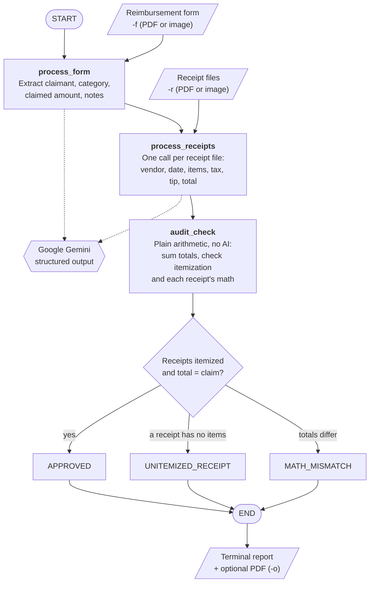
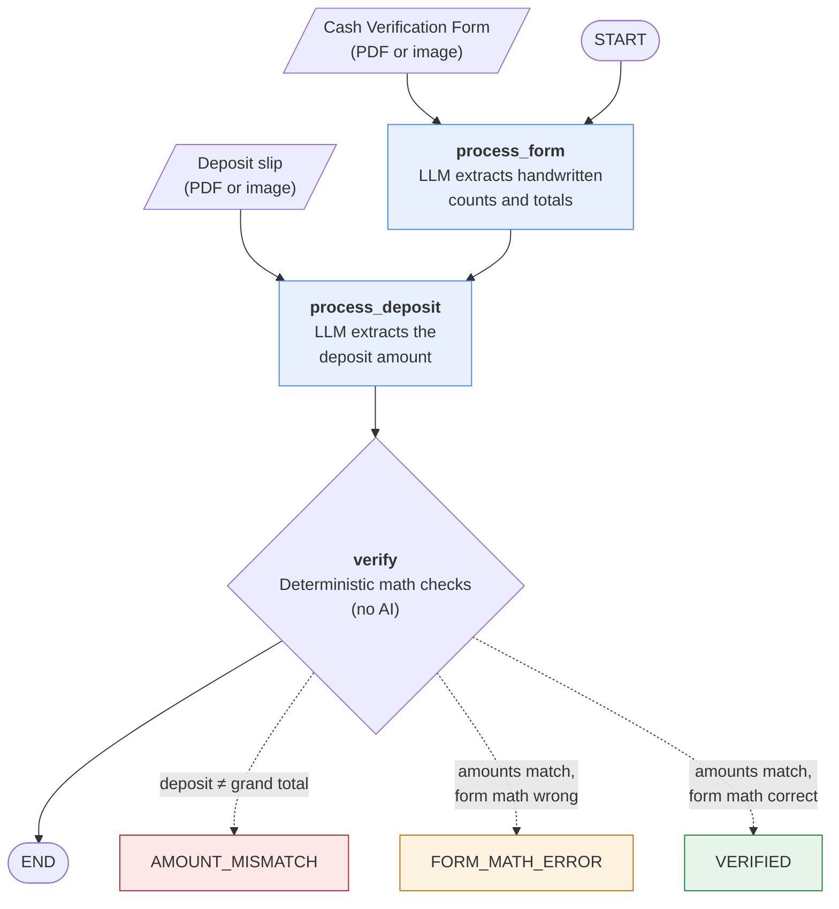

# PTA Treasurer Agent

Command-line AI agents that help a PTA treasurer check paperwork. Each tool reads
PDF scans or photos, extracts the key details with a vision LLM, and then checks
the numbers with plain arithmetic, no AI.

| Tool | Script | What it checks |
|---|---|---|
| [Reimbursement Agent](#reimbursement-agent) | `pta-reimbursement-agent.py` | The receipts support the amount claimed on a reimbursement form. |
| [Cash Verification Agent](#cash-verification-agent) | `pta-cash-agent.py` | The bank deposit matches the amount counted on the Cash Verification Form. |

## Requirements

- [uv](https://docs.astral.sh/uv/)
- [Poppler](https://poppler.freedesktop.org/), used to convert PDFs to images
  (macOS: `brew install poppler`, Debian/Ubuntu: `apt install poppler-utils`)
- A Google Gemini API key from [Google AI Studio](https://aistudio.google.com/).
  The Cash Verification Agent can instead run locally with [Ollama](https://ollama.com/)
  (see [Running locally with Ollama](#running-locally-with-ollama)).

## Setup

```bash
git clone https://github.com/indapa/pta-treasurer-agent.git
cd pta-treasurer-agent
uv sync
```

Store your API key in a `.env` file in the project folder (it is already in
`.gitignore`, so it won't be committed):

```bash
echo 'GOOGLE_API_KEY=your-key-here' > .env
chmod 600 .env
```

Both tools share this environment and API key.

---

## Reimbursement Agent

Audits PTA reimbursement requests. It reads a completed reimbursement form and
the supporting receipts, and checks that the receipts actually support the
amount being claimed.

### What it does

A small [LangGraph](https://github.com/langchain-ai/langgraph) workflow with three steps:

1. **Read the claim form** – extracts the claimant name, PTA event or budget
   category, claimed amount, and any notes.
2. **Read each receipt** – extracts the vendor, date, line items, tax, tip, and
   grand total. All pages of a receipt file are treated as one receipt, so a total
   repeated on a second page (for example, a payment confirmation) is not counted twice.
3. **Audit the claim** – plain arithmetic, no AI:
   - sums the receipt totals and compares them to the claimed amount
   - flags receipts with no itemized line items
   - flags receipts whose items + tax + tip don't add up to the receipt's total



The result is one of these statuses:

| Status | Meaning |
|---|---|
| `APPROVED` | Receipts are itemized and match the claimed amount (within $0.01). |
| `MATH_MISMATCH` | The claimed amount is higher or lower than the receipts support. |
| `UNITEMIZED_RECEIPT` | At least one receipt has no line items. |

The report is printed to the terminal and can also be saved as a PDF file.

### Usage

```bash
uv run --env-file .env pta-reimbursement-agent.py \
  -f reimbursement_form.pdf \
  -r receipt1.pdf receipt2.jpg receipt3.pdf \
  -o Jane_Doe
```

| Option | Description |
|---|---|
| `-f`, `--reimbursement_form` | The completed reimbursement form (PDF or image). Required. |
| `-r`, `--supporting_receipts` | One or more receipt files (PDF, PNG, JPG, JPEG, or WEBP), space-separated. Required. |
| `-o`, `--output` | Optional output prefix. The report is also written to `<prefix>_reimbursement_verification.pdf`, e.g. `Jane_Doe_reimbursement_verification.pdf`. |

Example terminal output:

```
==================================================
         PTA REIMBURSEMENT VERIFICATION REPORT
==================================================
Claimant:          Jane Doe
Category/Event:    Classroom Supplies
Status:            APPROVED
Claimed Amount:    $84.21
Supported Amount:  $84.21
Variance:          $0.00
--------------------------------------------------
EXTRACTED RECEIPT BREAKDOWN:
  1. Vendor: Office Depot | Date: 09/08/2026 | Total: $69.46
     - Folders (30): $50.40
     - Shipping: $15.16
     - [Tax]: $3.90
  2. Vendor: FedEx | Date: 09/10/2026 | Total: $14.75
     - Printing: $14.75
--------------------------------------------------
AUDIT NOTES & WARNINGS:
  * CLAIM VERIFIED: Receipts fully support the claimed amount.
==================================================
```

---

## Cash Verification Agent

Checks PTA cash deposits. It reads a completed California State PTA **Cash
Verification Form** and the bank **deposit slip or receipt**, and checks that
the amount deposited matches the amount counted on the form.

### What it does

A small [LangGraph](https://github.com/langchain-ai/langgraph) workflow with three steps:



1. **Read the Cash Verification Form**: extracts the unit name, activity, and date,
   then the handwritten count for each coin and bill, the coins, currency and checks
   totals, the grand total, and how many signature lines are signed. The form's
   pre-printed `0.00` placeholders and the "Start Up Cash" section are ignored.
2. **Read the deposit slip**: extracts the bank, date, masked account number, and
   the deposit amount (not the account's new or available balance), plus the cash
   and check portions if the slip lists them separately.
3. **Verify the deposit** using plain arithmetic, with no AI:
   - compares the deposit amount to the form's grand total
   - checks each line on the form (count × denomination = amount)
   - checks the coins and currency totals against their lines, and that
     coins + currency + checks = grand total
   - compares the cash and check portions of the deposit to the form, when the slip lists them
   - warns if fewer than two people signed the form

The result is one of these statuses:

| Status | Meaning |
|---|---|
| `VERIFIED` | The deposit matches the form's grand total (within $0.01) and the form's math is correct. |
| `AMOUNT_MISMATCH` | The deposit is more or less than the form's grand total. |
| `FORM_MATH_ERROR` | The deposit matches the grand total, but a line or subtotal on the form doesn't add up. |

The report is printed to the terminal and can also be saved as a PDF file.

### Usage

```bash
uv run --env-file .env pta-cash-agent.py \
  -f 5th_grade_popsicle_sales_20261002.pdf \
  -d 5th_grade_popsicle_sales_20261002.png \
  -o 5th_grade_popsicle_sales_20261002
```

To run locally instead, add `--provider ollama` (the `--env-file` is then optional).

| Option | Description |
|---|---|
| `-f`, `--cash_verification_form` | The completed Cash Verification Form (PDF or image). Required. |
| `-d`, `--deposit_slip` | The bank deposit slip or teller receipt (PDF, PNG, JPG, JPEG, or WEBP). Required. |
| `-o`, `--output` | Optional output prefix. The report is also written to `<prefix>_cash_deposit_slip_verification.pdf`. |
| `-p`, `--provider` | `gemini` (default) or `ollama` (local). Overrides `LLM_PROVIDER`. |
| `-m`, `--model` | Model for the chosen provider, e.g. `gemma3:12b` or `gemini-3.8-flash`. Overrides `OLLAMA_MODEL` / `GEMINI_MODEL`. |

Example terminal output:

```
==================================================
       PTA CASH DEPOSIT VERIFICATION REPORT
==================================================
Unit:              5TH GRADE PROMOTION COMMITTEE
Activity:          ICE CREAM SALES
Status:            VERIFIED
Form Grand Total:  $184.00
Deposit Amount:    $184.00
Variance:          $0.00
Form Date:         10/2/26
Deposit Date:      10/09/26
--------------------------------------------------
CASH VERIFICATION FORM COUNT:
    16 x 25¢   = $4.00
    75 x $1    = $75.00
    11 x $5    = $55.00
     1 x $10   = $10.00
     2 x $20   = $40.00
  Coins: $4.00 | Currency: $180.00 | Checks: $0.00
--------------------------------------------------
DEPOSIT SLIP:
  MISSION FED CREDIT UNION | Acct: XXXXXX4031 | Date: 10/09/26 | Amount: $184.00
--------------------------------------------------
VERIFICATION NOTES & WARNINGS:
  * DEPOSIT VERIFIED: Deposited amount matches the Cash Verification Form grand total.
==================================================
```

### Running locally with Ollama

Pass `--provider ollama` to the Cash Verification Agent. No API key is needed,
and your scans never leave your machine, but small local models misread
handwritten tables more often than Gemini.

```bash
brew install ollama          # or download the app from https://ollama.com/download
ollama serve                 # not needed if the Ollama menu-bar app is running
ollama pull qwen2.5vl:7b     # vision model, ~6 GB
```

Use a different model with `--model`, for example
`uv run pta-cash-agent.py --provider ollama --model gemma3:12b ...`. The model
must support images.

---

## Notes

- **Model:** the Gemini model is set by `GEMINI_MODEL` near the top of each script.
  For the Cash Verification Agent, `--provider` / `LLM_PROVIDER` selects `gemini`
  (default) or `ollama`, and `--model` / `OLLAMA_MODEL` picks the model
  (Ollama default `qwen2.5vl:7b`).
- **API limits (Gemini):** the Reimbursement Agent makes one request for the form
  and one per receipt file; the Cash Verification Agent makes two (form and deposit
  slip). Gemini's free tier allows only a few requests per minute per model, so a
  run may fail with `429 RESOURCE_EXHAUSTED`. Wait a minute and retry, or enable
  billing on your Google AI project.
- **Review the results:** the AI can misread a scan or handwriting. Check the
  extracted amounts against the original documents before approving a
  reimbursement or signing off on a deposit.
